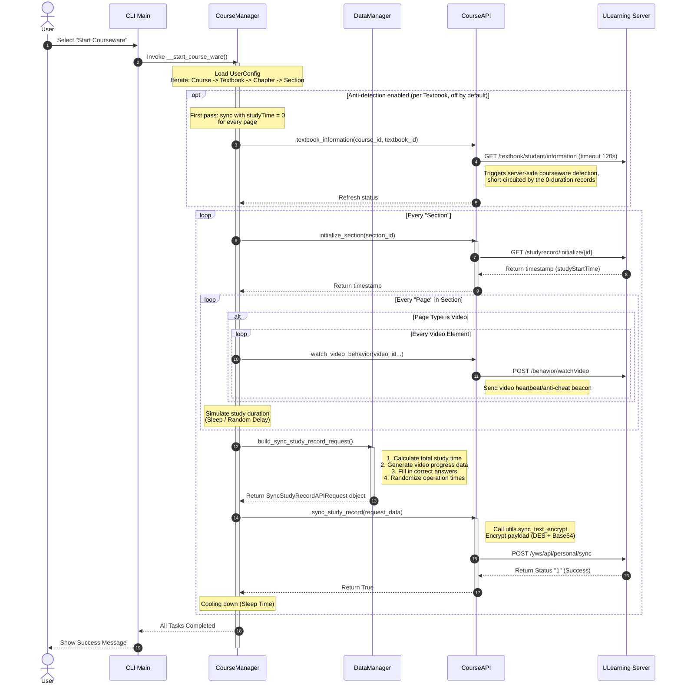

# UCourseAuto

English | [简体中文](README.md)

## What is UCourseAuto?

UCourseAuto is an automated CLI tool for completing courseware on the ULearning platform.

## Repository Structure

The CLI tool lives in the `cli/` directory as a standalone subproject with its own uv project files (`pyproject.toml`, `uv.lock`, `requirements.txt`). The source-run commands and data-file notes below are relative to `cli/`.

## Features

- Video watching with simulated progress
- Question answering with automatic solution lookup
- Document reading simulation
- Content page completion
- Customizable study time
- Anti-detection mode (optional, off by default, see below)
- Multiple users support
- Modify courseware configuration

## Support Sites

- ULearning Main Site https://www.ulearning.cn (the maintainer has no main-site data available for debugging, so main-site availability cannot be continuously verified — PRs are welcome)
- Dongguan University of Technology https://lms.dgut.edu.cn

## Usage

### Run from Binary

Download the latest executable from the [Releases](https://github.com/ChinoKou/UCourseAuto/releases/latest) page and run it directly — no Python setup required.

### Run from Source

[uv](https://docs.astral.sh/uv/) is recommended for managing the Python environment and dependencies:

```bash
git clone https://github.com/ChinoKou/UCourseAuto.git
cd UCourseAuto/cli
uv sync
uv run main.py
```

Alternative launch command: `uv run python -m src.main`

<details>
<summary>No uv yet? Click to see the install commands</summary>

Linux / macOS:

`curl -LsSf https://astral.sh/uv/install.sh | sh`

Windows (PowerShell):

`powershell -ExecutionPolicy ByPass -c "irm https://astral.sh/uv/install.ps1 | iex"`

</details>

Alternatively, set up the environment the traditional way with pip:

```bash
# Enter the cli subproject directory
cd UCourseAuto/cli

# Create a virtual environment
python -m venv .venv

# Activate it (Linux / macOS)
source .venv/bin/activate
# Activate it (Windows)
.venv\Scripts\activate

# Install dependencies
pip install -r requirements.txt

# Run with the environment activated
python main.py
```

## Configuration and Data Files

The program generates local data under the `cli/ucourse_data/` directory:

- `ucourse_config.json`: the configuration file, stored as plain JSON. Note: the account password is stored in plain text in this file. Keep the `ucourse_data/` directory private and never share it with others.
- `ucourse_logs/`: the runtime log directory.

A legacy `ucourse_config.yaml` from previous versions (in the project root) is migrated automatically to the new configuration on first run (the migrated configuration carries a version number, and the old file is removed afterwards) — no manual action required.

## Anti-Detection Mode (Optional, Off by Default)

Select "反刷课检测" in the courseware management menu to enable it. Once enabled, reporting for each textbook is split into two passes:

1. First pass: all pages are reported with a study time of 0. Based on observation, after a textbook is completed for the first time, querying it in the web frontend triggers the platform's information endpoint, which triggers courseware detection. At that moment the recorded study time is 0, which can short-circuit that detection (the client-side timeout of this endpoint is 120 seconds).
2. Second pass: the real study time is reported. After the system marks the courseware complete, teachers may check the study time, so the real duration must be filled in.

Notes:

- This feature is based on observation of the platform's frontend behavior. The platform may change its strategy at any time, so it is not guaranteed to work.
- If a network error occurs during the first pass and retries are exhausted, the study progress of the reported sections is lost.
- If the run is interrupted after the first pass, the courseware stays in a 0-duration but completed state, which is easy for teachers to spot manually.

## How It Works



## Terms and Conditions

By using this tool, you acknowledge that you understand the risks associated with using automation tools on ULearning platforms, and accept the following terms and conditions:

- The author does not guarantee that using this tool will not be detected by the ULearning platform
- Any consequences arising from the use of this tool, including but not limited to disciplinary action, are solely the responsibility of the user
