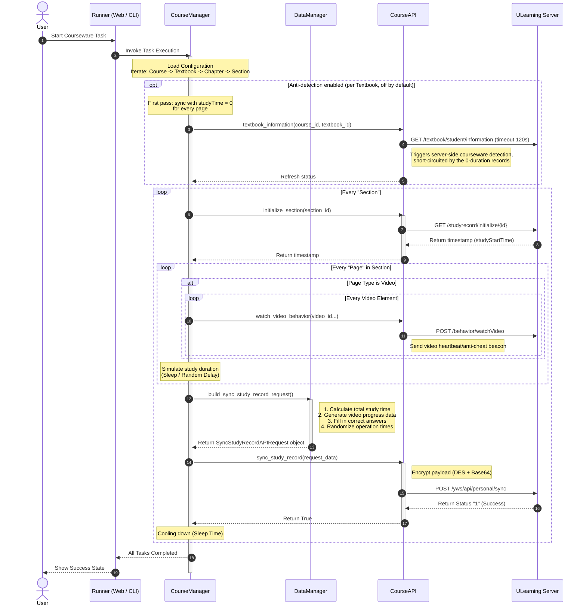

# UCourseAuto

English | [简体中文](README.md)

## About

UCourseAuto automates courseware tasks on the ULearning platform through a protocol client implemented in this repository, available as both a web and a command-line version.

- **Web Version (Online)**: A pure static client-side web application deployed on Cloudflare Pages. All network requests are sent directly from your browser to the ULearning platform with no backend server involved, eliminating the need to set up local environments.
- **CLI Version (Local)**: A terminal-based interactive utility written in Python, distributed as standalone binary executables or runnable directly from source code.

## Features

- Video playback (automatically simulating viewing progress and heartbeat behavior)
- Quiz answering (automatic solution lookup and submission)
- Document reading simulation
- Plain text page completion
- Customizable study durations (independent duration and random jitter for video, document, and question types)
- Configurable cooling intervals between sections
- Multi-account management with fast switching
- Anti-detection mode (experimental)
- Five-level courseware tree visual configuration (Course, Textbook, Chapter, Section, Page), supporting hierarchical selection and row-level removal
- Supported sites: ULearning Main Site https://www.ulearning.cn Dongguan University of Technology https://lms.dgut.edu.cn

About the main site: the maintainer has no main-site data available for debugging, so main-site availability cannot be continuously verified — PRs are welcome

## Usage

### 1. Web Version

#### 1.1 Online Access

- https://ucourseauto.chinokou.me
- https://uca.chinokou.me
- https://ucourseauto.pages.dev

Access any of the sites above in any modern web browser to enter the workbench directly.

#### 1.2 Local Development and Build

<details>
<summary>Local Development and Build</summary>

To run the web version locally, [Bun](https://bun.sh/) is recommended:

```bash
# Enter the webapp subproject directory
cd webapp

# Install dependencies
bun install

# Start local development server
bun run dev

# Build production assets
bun run build
```

Production assets are generated in the `webapp/dist/` directory.

</details>

### 2. CLI Version

#### 2.1 Run from Binary

Download the latest executable from the [Releases](https://github.com/ChinoKou/UCourseAuto/releases/latest) page and run it directly — no Python environment required.

#### 2.2 Run from Source

<details>
<summary>Run from Source</summary>

[uv](https://docs.astral.sh/uv/) is recommended for managing the Python environment and dependencies:

```bash
git clone https://github.com/ChinoKou/UCourseAuto.git
cd UCourseAuto/cli
uv sync
uv run main.py
```

Alternative launch command: `uv run python -m src.main`

<details>
<summary>No uv yet? Click to see the install commands</summary>

Linux / macOS:

`curl -LsSf https://astral.sh/uv/install.sh | sh`

Windows (PowerShell):

`powershell -ExecutionPolicy ByPass -c "irm https://astral.sh/uv/install.ps1 | iex"`

</details>

Alternatively, set up the environment with pip:

```bash
# Enter the cli subproject directory
cd UCourseAuto/cli

# Create a virtual environment
python -m venv .venv

# Activate it (Linux / macOS)
source .venv/bin/activate
# Activate it (Windows)
.venv\Scripts\activate

# Install dependencies
pip install -r requirements.txt

# Run the program
python main.py
```

</details>

## Repository Structure

The repository is organized into two subprojects:

- `webapp/` — Static web application subproject built with React 19, TypeScript, Vite 8, and Bun.
- `cli/` — Command-line tool subproject developed in Python 3.12+ with its own uv configuration.

## Configuration and Storage

- **Web Version**: All data is stored in the browser's `localStorage`. Configuration is stored under `ucourse_config`. Data remains strictly in the local browser; clearing browser cache or site data resets the configuration.
- **CLI Version**: Runtime data is created under the `cli/ucourse_data/` directory:
  - `ucourse_config.json`: Configuration file stored as plain JSON. Account passwords are saved in plain text; keep the `ucourse_data/` directory private and do not share it.
  - `ucourse_logs/`: Directory for runtime execution logs.
  Legacy `ucourse_config.yaml` from earlier versions in the repository root is migrated automatically on first launch and removed afterwards.

## Anti-Detection Mode (Optional, Off by Default)

Enable "Anti-detection" in the courseware settings or the execution console. Once enabled, reporting for each textbook is processed in two stages:

1. Stage 1: Report all pages with a study time of 0. Based on observation of platform frontend behavior, querying a newly completed textbook triggers the platform's information endpoint, which initiates courseware detection; with 0 duration recorded on the platform side at this point, the detection can be short-circuited.
2. Stage 2: Report actual study time. After completion is marked by the platform, actual study durations are submitted.

Notes:

- This feature is based on observation of platform frontend behavior; the platform may change its behavior at any time, so long-term effectiveness is not guaranteed.
- If a network failure occurs during the first stage and retries are exhausted, study records for reported sections may be lost.
- Interrupting the task after the first stage is complete leaves the courseware completed with 0 study duration, which is easy to identify during manual inspection.

## How It Works (CLI Version)



## Terms and Conditions

By using this tool, you acknowledge that you understand the risks associated with using automation tools on ULearning platforms, and accept the following terms and conditions:

- The author does not guarantee that using this tool will not be detected by the ULearning platform.
- Any consequences arising from the use of this tool, including but not limited to disciplinary action, are solely the responsibility of the user.
