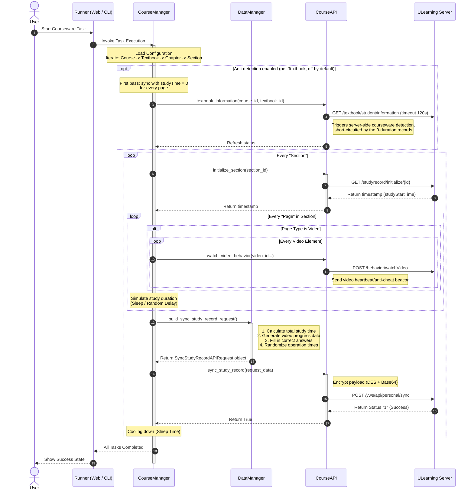

# UCourseAuto

[English](README.en.md) | 简体中文

## 关于

UCourseAuto 是一个用于自动完成 优学院 平台课件的自动化协议客户端

## 功能特性

- 视频观看（自动模拟观看进度与心跳行为）
- 答题（自动查询答案并提交）
- 文档阅读模拟
- 纯文本页面完成
- 自定义学习时长（针对文档、题目等类型分别设定时长与随机浮动）
- 自定义小节冷却间隔
- 多账号管理与快捷切换
- 反刷课检测（实验性功能）
- 五层课件树可视化配置（课程、教材、章、节、页面），支持多级选择与行级删除
- 支持站点：优学院主站 https://www.ulearning.cn 东莞理工学院 https://lms.dgut.edu.cn

关于主站：维护者手头没有可用于调试的主站数据，主站可用性无法持续验证，欢迎 PR

## 使用方法

### 一、网页版

部署于 Cloudflare Pages 的纯静态前端应用。所有网络请求由浏览器直接发送至 优学院 平台，无任何服务端参与，无需配置开发环境。

用现代浏览器访问以下任一站点即可进入工作台：

- https://ucourseauto.chinokou.me
- https://uca.chinokou.me
- https://ucourseauto.pages.dev

<details>
<summary>本地开发与构建</summary>

推荐使用 [Bun](https://bun.sh/)：

```bash
# 进入 webapp 子项目目录
cd webapp

# 安装依赖
bun install

# 启动本地开发服务
bun run dev

# 构建生产环境静态资源
bun run build
```

构建生成的静态文件位于 `webapp/dist/` 目录。

</details>

### 二、命令行版本

基于 Python 编写的终端交互工具。前往 [Releases](https://github.com/ChinoKou/UCourseAuto/releases/latest) 页面下载最新的可执行文件，无需配置 Python 环境，下载后直接运行。

<details>
<summary>源码运行</summary>

推荐使用 [uv](https://docs.astral.sh/uv/) 管理 Python 环境与依赖：

```bash
git clone https://github.com/ChinoKou/UCourseAuto.git
cd UCourseAuto/cli
uv sync
uv run main.py
```

备选启动命令：`uv run python -m src.main`

<details>
<summary>尚未安装 uv？展开查看安装命令</summary>

Linux / macOS：

`curl -LsSf https://astral.sh/uv/install.sh | sh`

Windows（PowerShell）：

`powershell -ExecutionPolicy ByPass -c "irm https://astral.sh/uv/install.ps1 | iex"`

</details>

如果不使用 uv，也可以按传统方式使用 pip 准备运行环境：

```bash
# 进入 cli 子项目目录
cd UCourseAuto/cli

# 创建虚拟环境
python -m venv .venv

# 激活虚拟环境（Linux / macOS）
source .venv/bin/activate
# 激活虚拟环境（Windows）
.venv\Scripts\activate

# 安装依赖
pip install -r requirements.txt

# 运行程序
python main.py
```

</details>

## 仓库结构

仓库划分为两个子项目目录：

- `webapp/` — 静态网页子项目，使用 React 19、TypeScript、Vite 8 与 Bun 构建。
- `cli/` — 命令行工具子项目，使用 Python 3.12+ 开发，自带 uv 工程配置。

## 配置与数据存储

- **网页版**：所有数据存储于浏览器的 `localStorage` 中。配置保存在 `ucourse_config`。数据仅留存于本地浏览器，清除浏览器缓存或站点数据会导致配置重置。
- **命令行版本**：程序运行时在 `cli/ucourse_data/` 目录下生成本地数据：
  - `ucourse_config.json`：配置文件，JSON 明文保存。账号密码以明文形式保存在该文件中，请妥善保管，切勿将 `ucourse_data/` 目录分享给他人。
  - `ucourse_logs/`：运行日志目录。
  旧版本在项目根目录生成的 `ucourse_config.yaml` 会在首次运行时自动迁移为新配置，旧文件会在迁移完成后移除。

## 反刷课检测（可选，默认关闭）

在课件设置或运行控制台中开启「反刷课检测」。开启后，每个教材的上报过程分为两个阶段：

1. 第一阶段：将所有页面的学习时长以 0 上报。根据对平台前端行为的观察，首次完成教材并且在前端查询时会触发平台的 information 接口，该接口会触发刷课检测行为；此时平台侧记录的学习时长为 0，可以尝试短路这次检测。
2. 第二阶段：上报实际学习时长。系统判定完成之后，补全实际时长数据。

注意事项：

- 该功能基于对平台前端行为的观察，平台随时可能调整策略，无法保证长期有效。
- 第一阶段上报进行过程中若发生网络错误且重试耗尽，已上报小节的学习进度会丢失。
- 若第一阶段上报完成后中断任务，课件将处于学习时长为 0 且显示已完成的状态，容易被人工排查发现。

## 工作原理（命令行版本）



## 使用条款

使用本工具即表示已知晓在 优学院 平台上使用自动化工具的相关风险，并接受以下条款：

- 作者不保证使用本工具不会被 优学院 平台检测到。
- 因使用本工具产生的一切后果（包括但不限于纪律处分）均由使用者自行承担。
