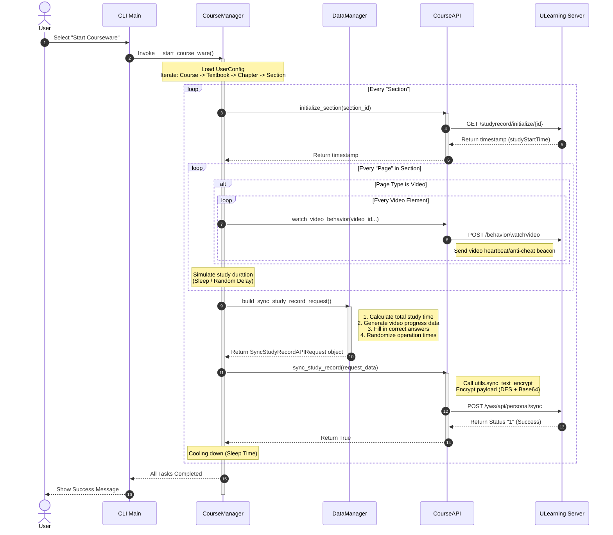

# UCourseAuto

[English](README.en.md) | 简体中文

## UCourseAuto 是什么？

UCourseAuto 是一个用于自动完成 优学院 平台课件的命令行自动化工具。

## 功能特性

- 视频观看（模拟观看进度）
- 答题（自动查询答案）
- 文档阅读模拟
- 纯文本页面完成
- 自定义学习时长
- 多用户支持
- 课件配置修改

## 支持站点

- 优学院主站 https://www.ulearning.cn
- 东莞理工学院 https://lms.dgut.edu.cn

## 使用方法

- 从 [Releases 页面](https://github.com/ChinoKou/UCourseAuto/releases/latest) 下载最新的二进制文件，直接运行
- 克隆本仓库，使用 Python 3.12+ 直接运行

## 工作原理

## 使用条款

使用本工具即表示你已知晓在 优学院 平台上使用自动化工具的相关风险，并接受以下条款：

- 作者不保证使用本工具不会被 优学院 平台检测到
- 因使用本工具产生的一切后果（包括但不限于纪律处分）均由用户自行承担
