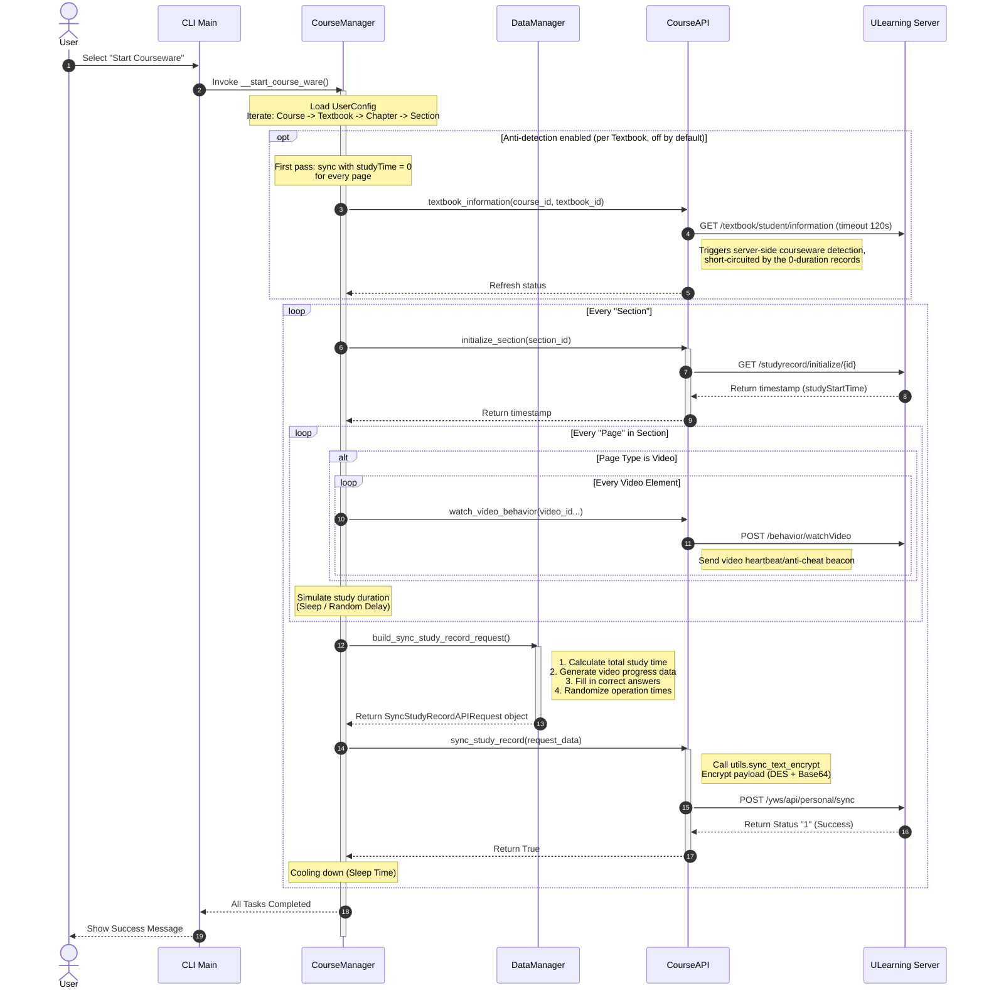

# UCourseAuto

[English](README.en.md) | 简体中文

## UCourseAuto 是什么？

UCourseAuto 是一个用于自动完成 优学院 平台课件的命令行自动化工具。

## 仓库结构

命令行工具位于 `cli/` 目录，作为独立子项目自带 uv 工程配置（`pyproject.toml`、`uv.lock`、`requirements.txt`），下文的源码运行命令与数据文件说明均以 `cli/` 为根。

## 功能特性

- 视频观看（模拟观看进度）
- 答题（自动查询答案）
- 文档阅读模拟
- 纯文本页面完成
- 自定义学习时长
- 反刷课检测（可选，默认关闭，见下文说明）
- 多用户支持
- 课件配置修改

## 支持站点

- 优学院主站 https://www.ulearning.cn （维护者手头没有可用于调试的主站数据，主站可用性无法持续验证，欢迎 PR）
- 东莞理工学院 https://lms.dgut.edu.cn

## 使用方法

### 二进制运行

前往 [Releases](https://github.com/ChinoKou/UCourseAuto/releases/latest) 页面下载最新的可执行文件，无需配置 Python 环境，下载后直接运行。

### 源码运行

推荐使用 [uv](https://docs.astral.sh/uv/) 管理 Python 环境与依赖：

```bash
git clone https://github.com/ChinoKou/UCourseAuto.git
cd UCourseAuto/cli
uv sync
uv run main.py
```

备选启动方式：`uv run python -m src.main`

<details>
<summary>尚未安装 uv？展开查看安装命令</summary>

Linux / macOS：

`curl -LsSf https://astral.sh/uv/install.sh | sh`

Windows（PowerShell）：

`powershell -ExecutionPolicy ByPass -c "irm https://astral.sh/uv/install.ps1 | iex"`

</details>

如果不使用 uv，也可以按传统方式用 pip 手动准备环境：

```bash
# 进入 cli 子项目目录
cd UCourseAuto/cli

# 创建虚拟环境
python -m venv .venv

# 激活虚拟环境（Linux / macOS）
source .venv/bin/activate
# 激活虚拟环境（Windows）
.venv\Scripts\activate

# 安装依赖
pip install -r requirements.txt

# 激活状态下运行
python main.py
```

## 配置与数据文件

程序运行时在 `cli/ucourse_data/` 目录下生成本地数据：

- `ucourse_config.json`：配置文件，JSON 明文保存。注意：账号密码以明文形式保存在该文件中，请自行妥善保管，不要将 `ucourse_data/` 目录分享给他人。
- `ucourse_logs/`：运行日志目录。

旧版本在项目根目录生成的 `ucourse_config.yaml` 会在首次运行时自动迁移为新配置（迁移后配置带版本号，旧文件会被移除），无需手动处理。

## 反刷课检测（可选，默认关闭）

在课件管理菜单中选择「反刷课检测」可以开启该功能。开启后，每个教材的上报分为两段：

1. 第一段：将所有页面的学习时长以 0 上报。据观察，第一次刷完一个教材并且用户在前端查询时会触发平台的 information 接口，该接口会触发刷课检测；此时平台侧记录的学习时长为 0，可以尝试短路这次检测（该接口的客户端超时为 120 秒）。
2. 第二段：上报真实的学习时长。系统判定完成之后，老师可能会查看学习时长，因此需要补上真实时长。

注意事项：

- 该功能基于对平台前端行为的观察，平台随时可能调整策略，不保证一直有效。
- 第一段上报进行时若出现网络错误且重试耗尽，已上报节的学习进度会丢失。
- 若第一段上报完成后中断刷课，课件将处于 0 时长但已完成的状态，容易被老师等人工排查发现。

## 工作原理



## 使用条款

使用本工具即表示你已知晓在 优学院 平台上使用自动化工具的相关风险，并接受以下条款：

- 作者不保证使用本工具不会被 优学院 平台检测到
- 因使用本工具产生的一切后果（包括但不限于纪律处分）均由用户自行承担
